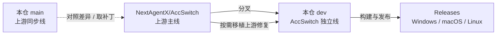

<p align="center">
  
</p>

<h1 align="center">AccSwitch</h1>

<p align="center">
  <b>WorkBuddy · CodeBuddy · TraeWork · Qoder 多账号工作台</b><br />
  把「现在登的是哪个号」变成一次点击
</p>

<p align="center">
  
  <a href="https://github.com/qiuyongjun/AccSwitch/releases/latest"></a>
  <a href="./LICENSE"></a>
  <a href="https://github.com/NextAgentX/AccSwitch"></a>
</p>

> **非官方第三方工具**（source-available，PolyForm Noncommercial 许可）。与 WorkBuddy / CodeBuddy / TraeWork / Qoder 及其权利人不存在隶属、授权或背书关系。它会读写本机客户端的认证数据、按你的配置自动发起请求，并可通过本地端口转发额度。使用前请读完 **[免责声明](docs/policies/DISCLAIMER.md)**。

## 仓库来源（Fork 说明）

本仓是 [NextAgentX/AccSwitch](https://github.com/NextAgentX/AccSwitch)（曾用名 `NextAgentX/qoder-trae-workbuddy-switch`）的衍生分支：保留上游的「本地多账号工作台」底座，在其上做品牌独立、信息架构与账号工作台重构，并独立构建与发布桌面安装包。

| 项 | 说明 |
| --- | --- |
| 上游 | [NextAgentX/AccSwitch](https://github.com/NextAgentX/AccSwitch)，本项目由其分叉而来 |
| 本仓 | [qiuyongjun/AccSwitch](https://github.com/qiuyongjun/AccSwitch)，非官方衍生版本，独立维护与发布 |
| 关系 | 不属于上游官方发行版；上游与本仓各自独立演进，功能不保证对齐 |
| 数据目录 | 仍为 `~/.buddy-switch/`，旧版账号库、网关 Key、签到与用量记录可直接沿用，无需迁移 |
| 版本线 | 本仓独立（`2026.11.x`），与上游版本号不连续；安装包与自动更新只认本仓 Releases |
| 许可 | PolyForm Noncommercial 1.0.0；原始版权与 Required Notice 保留在 [LICENSE](./LICENSE) |



## 分支说明

| 分支 | 角色 | 说明 |
| --- | --- | --- |
| `dev` | **开发主线 / 发布线** | 本仓全部改造、新增功能与上游修复移植都在这里；安装包与 Release 由它构建。日常开发与使用请认准这条分支 |
| `main` | 上游同步线 | 跟随 NextAgentX 上游同步，用于对照差异、挑选可移植的修复；不承载本仓改造 |
| `wip/pre-pull-*`、`wip/pre-merge-*` | 临时备份 | 拉取 / 合并前的一次性快照，不用于开发或发布 |

同步策略是**只挑「修错」类提交移植，不做整块合并**；新功能按独立功能块评估，避免把两套信息架构混在一起。判据、已移植清单与剩余缺口见 [上游合并收尾记录](docs/history/upstream-merge-closure-2026-11-02.md)。

## 基础功能（继承自上游）

底座能力与上游一致：一个本地运行的工作台，把三条产品线 × 国内外两个区域的账号收在一处，所有数据只落在本机。

| 能力 | 内容 |
| --- | --- |
| 6 个作用域 | WorkBuddy / TraeWork / Qoder × 国内 / 国际，各有独立账号库、客户端配置与网关 Key |
| 账号与登录 | 扫码、网页登录、设备码、PAT、本机导入；卡片 / 表格双视图；程序位切换；回收站保留 30 天 |
| 一键切号 | 先备份 → 关闭客户端 → 写入 → 校验 → 重启；写入失败自动回滚，客户端运行中默认拒写 |
| 签到与积分 | 三平台签到、积分与套餐；WorkBuddy 自动旅行 / 自动轮换；计划任务支持分钟粒度与随机抖动 |
| 用量统计 | Token、积分、账号 × 模型限流；趋势 / 模型 / 会话 / 积分四视图 |
| 会话副本 | 仅 WorkBuddy：内容指纹、谁落后谁分叉、加法同步、记忆与连接器合并 |
| 额度网关 | 四条独立监听 + 统一网关；OpenAI / Anthropic 兼容接口与 SSE 流式；账号池选号与模型限流 |
| 应用能力 | 主题与语言、开机启动、托盘、自动更新；全局备份恢复；Skill 管理；客户端 `settings.json` 托管；会话悬浮窗与 hook |
| 三种形态 | 桌面 App、webui（源码构建）、Docker headless（只跑服务端，不切换本机客户端） |
| 数据与隐私 | 全部数据落 `~/.buddy-switch/`；导出默认不含 token；网关 Key 只存哈希与前缀 |

端口固定为 `5789x` 一段：`57890` 界面 · `57891` WorkBuddy 网关 · `57892` 统一网关 · `57893` 会话 hook · `57894` Trae 网关 · `57895` Qoder 网关。

## 本仓改动了什么

相对上游分叉点，本仓改动集中在品牌、信息架构、账号工作台与可靠性；业务能力本身保持不变，新增能力见下一节。

| 方面 | 上游基线 | 本仓现在的做法 |
| --- | --- | --- |
| 品牌与发布 | Buddy Switch，上游 identifier、更新签名与发布通道 | AccSwitch，独立 identifier（`com.qiuyongjun.accswitch`）、更新签名与 Release 通道；旧版无法应用内升级，需手动安装一次 |
| 信息架构 | 三平台各 6 个目的地（含「概览」） | 收敛为 5 个：账号 · 用量 · 会话 · 网关 · 设置；概览页移除，`/token-stats`、`/credit-stats` 等旧路由重定向到统一用量页 |
| 账号工作台 | 三平台各写一套，卡片 / 抽屉细节不一致 | 三平台同构重构：卡片、表格、抽屉统一口径；指标行固定为「积分 · 临期 · 优先」；抽屉改页签 + 指标块；「更多」动作收敛；分组 / 备注 / 批量操作 |
| 账号库可靠性 | 整份 `load → save`，并发与跨进程会丢更新 | Trae / Qoder 账号库写路径事务化：文件级互斥 + 同线程重入 + 跨进程乐观重试，写路径读改为 fail-closed；见 [ACCOUNTS-TXN.md](docs/specs/ACCOUNTS-TXN.md) |
| 设置入口 | 设置页 9 个分区，三个客户端页重复出现通用项 | 收窄为 7 个分区；通用与备份恢复移到顶栏「应用设置」抽屉；客户端设置改为顶层键就地编辑；移除打赏入口 |
| Qoder 换号 | 要求用户先自行退出客户端 | 桌面版自动「关闭 → 写入 → 校验 → 重开」，失败把客户端拉回；CLI 仍不替用户杀终端会话（D56） |
| 刷新与签到 | 批量失败只报数量 | Trae 一键刷新下发逐账号失败原因，凭据失效标记「需重新登录」；Qoder 额度改为有界并发、签到改「列表快照 + 本地台账 + 抽屉按需补取」 |
| 发布渠道 | 提供 Docker 预构建镜像与在线演示 | 本仓只发布桌面安装包；Docker 预构建镜像与在线演示暂未启用，webui 仍可从源码构建 |
| 刻意未纳入 | — | 上游的聚合账号页、P13 模型降级链、Qoder 逐资源包明细、CodeBuddy CLI 接入、探测 / 风控遥测等整块功能（截至 2026-11-02，理由见合并记录） |

## 本仓新增了什么

在分叉点之后新增或补齐的能力。标注「移植」的来自上游后续提交，本仓只取语义、不取上游的品牌与界面。

| 能力 | 来源 | 说明 |
| --- | --- | --- |
| 成长任务中心 | 本仓 | WorkBuddy 国内版账号抽屉新增「任务」页签：任务列表、报名、行为事件点亮、回读、领奖；覆盖 11 个纯事件即可完成的任务，已领 / 已达标自动跳过 |
| 密钥配额与账号白名单 | 移植（上游 #76） | 每把网关 Key 可设请求配额与账号白名单，白名单是选号硬约束；用量页可按密钥查看消耗与权限 |
| 模型冷却与闸门 | 移植（上游 #88） | 冷却来源可辨、模型闸门暂停回 503 而非 401、探针票按请求归属并归还、`/status` 补齐诊断字段 |
| Anthropic 出口用量 | 移植（上游 #139） | `/v1/messages` 的 `input_tokens` 不再写死 0，上下文占用与缓存命中可见 |
| 图片链路 | 移植 | `/v1/messages` 图片转发开关（默认丢弃但留痕）；Qoder 带图消息保留多模态 `parts`，图片真正到达上游 |
| Qoder Responses | 移植 | `/v1/responses` 做协议翻译，不再返回 501；支持 freeform / custom 工具，Codex 的 `apply_patch` 不再被静默丢弃 |
| 工程门禁 | 本仓 | 新增 `check:rust`、`verify` 与「早退后调 hook」静态门禁，补上「前端全绿、Rust 编译不过」的盲区 |

## 下载与安装

| 平台 | 安装包 | 安装 |
| --- | --- | --- |
| macOS Apple Silicon（arm64） | `AccSwitch_<版本>_aarch64.dmg` | 打开 DMG，把 `AccSwitch.app` 拖进「应用程序」 |
| macOS Intel（x86_64） | `AccSwitch_<版本>_x86_64.dmg` | 同上 |
| Windows x64 | `AccSwitch_<版本>_x64-setup.exe` | 运行安装程序 |
| Linux x64 | `AccSwitch_<版本>_amd64.deb` / `.AppImage` | 装 `.deb`，或给 AppImage 加执行权限后直接运行 |

安装包统一在 [Releases](https://github.com/qiuyongjun/AccSwitch/releases/latest) 下载。

> **从上游旧版升级**：本仓更换了 updater 签名密钥与应用 identifier，旧版无法通过应用内自动更新升级到本版。请先退出旧版并手动安装新包；建议先卸载旧版再安装，避免两份应用同时运行并写入同一个 `~/.buddy-switch/` 数据目录。安装新版后，后续版本可在应用内直接升级。

<details>
<summary><b>macOS 提示「无法验证开发者」／切换时提示无权限</b></summary>

- 无法验证开发者：Finder 里按住 Control 点击应用 → 「打开」，或到「系统设置 → 隐私与安全性」→「仍要打开」。
- 切换账号需要写入客户端认证文件：在「系统设置 → 隐私与安全性」的 **App 管理**（或 **完全磁盘访问**）中授权 AccSwitch，然后重启应用。设置页的「权限检测」可随时验证。
- webui 形态的权限跟随启动服务的终端进程。

</details>

## 从源码运行

```bash
npm install
npm run tauri dev     # 桌面端开发
npm run verify        # 提交前跑：前端门禁 + cargo check --workspace --all-targets
```

webui（前端产物在编译期被服务端嵌入，顺序不能反）：

```bash
npm install
npm run build                                    # 1) 前端 → dist/
cargo build --release -p buddy-switch-server     # 2) 编译服务端（把 dist/ 嵌进去）
./target/release/buddy-switch                    # 3) 起服务并打开浏览器（默认 127.0.0.1:57890）
```

> `npm run build` 只跑前端门禁，不含 Rust 编译；改过 `crates/` 或 `src-tauri/` 时必须另跑 `npm run check:rust`（或直接 `npm run verify`）。

## 界面预览

<table>
  <thead>
    <tr><th>WorkBuddy 账号（浅色）</th><th>WorkBuddy 账号（深色）</th></tr>
  </thead>
  <tbody>
    <tr>
      <td></td>
      <td></td>
    </tr>
  </tbody>
</table>

<table>
  <thead>
    <tr><th>用量 · 趋势（浅色）</th><th>用量 · 趋势（深色）</th></tr>
  </thead>
  <tbody>
    <tr>
      <td></td>
      <td></td>
    </tr>
  </tbody>
</table>

<details>
<summary><b>更多截图（网关 / 会话 / 设置 / TraeWork 账号 / Qoder 账号）</b></summary>

<table>
  <thead>
    <tr><th>网关（浅色）</th><th>网关（深色）</th></tr>
  </thead>
  <tbody>
    <tr>
      <td></td>
      <td></td>
    </tr>
  </tbody>
</table>

<table>
  <thead>
    <tr><th>Qoder 网关（浅色）</th><th>Qoder 网关（深色）</th></tr>
  </thead>
  <tbody>
    <tr>
      <td></td>
      <td></td>
    </tr>
  </tbody>
</table>

<table>
  <thead>
    <tr><th>会话副本（浅色）</th><th>会话副本（深色）</th></tr>
  </thead>
  <tbody>
    <tr>
      <td></td>
      <td></td>
    </tr>
  </tbody>
</table>

<table>
  <thead>
    <tr><th>设置（浅色）</th><th>设置（深色）</th></tr>
  </thead>
  <tbody>
    <tr>
      <td></td>
      <td></td>
    </tr>
  </tbody>
</table>

<table>
  <thead>
    <tr><th>TraeWork 账号（浅色）</th><th>TraeWork 账号（深色）</th></tr>
  </thead>
  <tbody>
    <tr>
      <td></td>
      <td></td>
    </tr>
  </tbody>
</table>

<table>
  <thead>
    <tr><th>Qoder 账号（浅色）</th><th>Qoder 账号（深色）</th></tr>
  </thead>
  <tbody>
    <tr>
      <td></td>
      <td></td>
    </tr>
  </tbody>
</table>

</details>

> 图由 `scripts/gen-readme-shots.mjs` 从演示构建（`VITE_DEMO_MODE=1`）自动生成，账号、积分与请求记录均为虚构数据；界面改版后重跑一次即可同步。

## 文档

完整索引在 [docs/README.md](docs/README.md)。最常翻的几份：

| 文档 | 讲什么 |
| --- | --- |
| [guides/DEVELOPMENT.md](docs/guides/DEVELOPMENT.md) | 环境要求、本地开发、门禁清单、发布流程、目录约定 |
| [guides/DOCKER.md](docs/guides/DOCKER.md) | 容器部署：源码构建、端口与安全、排障 |
| [guides/GATEWAY-CLIENT-INTEGRATION.md](docs/guides/GATEWAY-CLIENT-INTEGRATION.md) | 把 Codex / Claude Code / 其它客户端接到本机网关 |
| [specs/](docs/specs/) | 现行架构与决策（改代码前该读的依据） |
| [history/upstream-merge-closure-2026-11-02.md](docs/history/upstream-merge-closure-2026-11-02.md) | 与上游的差异、已移植清单与刻意未做的功能块 |
| [releases/](docs/releases/) | 每版发布说明 |

> `README.en.md` 等 7 个语言版本仍是上游原文，未同步本仓差异；以本文件为准。

## 致谢

- 上游项目：**NextAgentX/AccSwitch**（PolyForm Noncommercial 1.0.0）。本仓基于其衍生开发，原始版权与 Required Notice 保留在 [LICENSE](./LICENSE)。
- [changexbc/workbuddy-switch](https://github.com/changexbc/workbuddy-switch) — 借鉴 WorkBuddy 账号数据格式与多账号切换思路。
- [Sliverkiss/workbuddy2api](https://github.com/Sliverkiss/workbuddy2api) — 借鉴把模型额度封装成 OpenAI 兼容接口的思路。

以上项目各自遵循其自身许可；本仓为独立实现，与它们不存在隶属、合作或背书关系，相关名称与商标归各自权利人所有。

## 免责声明与许可

- 使用前请读完 **[免责声明](docs/policies/DISCLAIMER.md)**：非官方第三方工具、服务条款与合规自理、数据写入与备份、自动化行为风险、API 网关暴露风险、按「原样」提供。
- 许可为 **[PolyForm Noncommercial License 1.0.0](./LICENSE)**：个人非商业使用允许，**商业使用不被授权**。白话说明与常见问题见 [docs/policies/LICENSING.md](docs/policies/LICENSING.md)。
